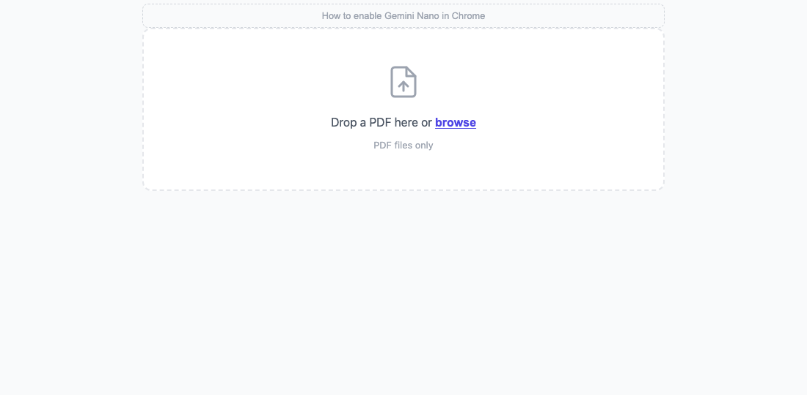

# doc-extractor


Static web page that extracts structured information (type, title, author, date, summary, or any
fields you define) from PDF documents, using AI that runs **in the browser**. Nothing is uploaded to
a server: the PDF is read and analysed on the user's machine.



## Engines

The page detects which engines the browser can run and lets you pick one:

| Engine | Needs |
|---|---|
| Gemini Nano (multimodal / text) | Chrome 128+ with the Prompt API flags (the page explains how) |
| Florence-2 + wllama | ~570 MB model download, on-device vision OCR |
| Tesseract.js + wllama | ~370 MB model download, traditional OCR |

The libraries (pdf.js, tesseract.js + core, transformers.js + onnxruntime wasm, wllama) are
**self-hosted** under `/vendor/<lib>@<exact version>/`: `scripts/vendor.sh` downloads each from the npm
registry at a pinned version and checks a pinned SHA-512 before unpacking; the Dockerfile runs it in a
build stage, and `site/vendor/` is git-ignored (run the script by hand to use `site/` outside Docker).
To bump a library, change its version and checksum in the script and the path in `site/app.js` /
`site/index.html`. Only data is fetched from remote hosts at runtime, so the browser still needs
internet access: model weights (Hugging Face, which redirects to `*.hf.co`) and Tesseract language
data (jsDelivr). `security-headers.inc` sets a Content-Security-Policy that allows scripts from
`'self'` only (plus `'wasm-unsafe-eval'`) and `connect-src` to those hosts; if a library starts loading
something new, the browser console shows the violation and `connect-src` / `scripts/vendor.sh` need updating.

## Layout

```
site/             index.html, style.css, app.js (the whole app), favicon.svg (+ vendor/, generated)
scripts/vendor.sh downloads and verifies the self-hosted libraries into site/vendor/
security-headers.inc  COOP/COEP, CSP, HSTS, Referrer-Policy (included by every nginx location)
docs/             screenshot.png, icon.png (512 px render of site/favicon.svg)
nginx.conf        serves site/ on :3000, /health, cache rules: /vendor immutable for 1 year, index.html no-cache, app.js/style.css/favicon 1 h
Dockerfile        vendor stage + nginxinc/nginx-unprivileged:1.28.2-alpine-slim (~50 MB image, 35 MB of it wasm)
docker-compose.yml, deploy.sh   deploy to the Raspberry Pi (see below)
```

## Run locally

```bash
DOCKER_CONTEXT=desktop-linux docker compose up -d --build   # http://localhost:3004
```

`docker-compose.yml` joins the external network `localinfra_tunnel`, so local-infra must be running on
Docker Desktop (or run the image directly: `docker run --rm -p 3004:3000 $(docker build -q .)`).
`.env` (git-ignored) only holds `PORT=3004`.

## Deploy (Raspberry Pi)

Same flow as the other apps (`local-infra/DEPLOYING-APPS.md`): from the Mac, through the `umbrel`
Docker context; the image is built on the Mac (linux/arm64) and loaded into the Pi.

```bash
./deploy.sh              # build, send, restart, wait for healthy
./deploy.sh --rollback   # back to the previous image
```

### Public access (Cloudflare tunnel)

Cloudflare Zero Trust → Networks → Tunnels → `localinfra-tunnel` → *Published application routes* →
add a route: hostname `doc-extractor.khoe.dev` (it is the address the Container Health map links to, set by the `localinfra.url` label), service type `HTTP`, URL `doc-extractor:3000`.

The container already joins `localinfra_tunnel`, so no other change is needed. The page is public
and has no login; anything it does happens in the visitor's browser.
